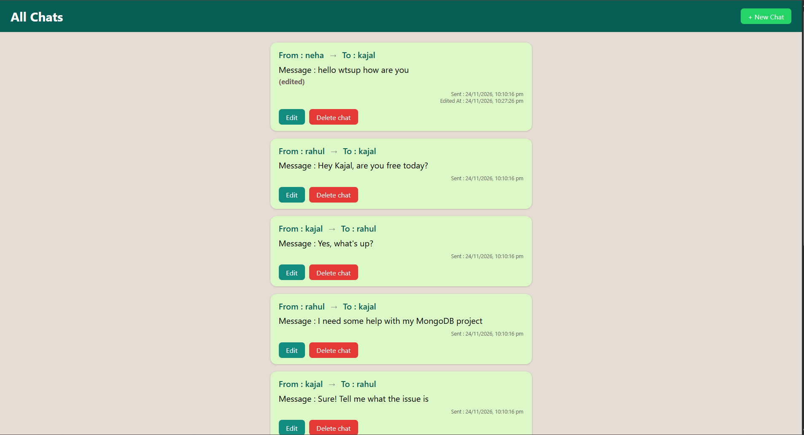
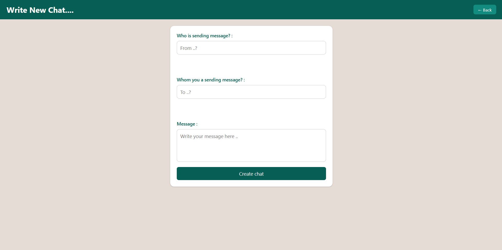
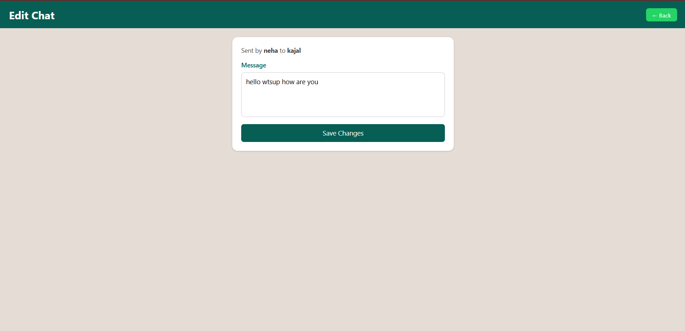

# 💬 Mini Chat App

A mini WhatsApp-inspired chat app built with **Node.js, Express, EJS and MongoDB (Mongoose)**.
It was built as a practice project to learn how Express works with MongoDB for the first time.


---

## 📸 Screenshots

> Add your screenshots here after saving them in a `screenshots/` folder.

| All Chats | New Chat | Edit Chat |
|-----------|----------|-----------|
|  |  |  |

---

## ✨ Features

- **Create** a new chat with sender, receiver and message
- **Read** all chats, with the date and time each one was sent
- **Update** a message, which is then marked as **(edited)** with the edit time
- **Delete** a chat, with a confirmation popup
- **Automatic timestamps** using Mongoose (`createdAt` and `updatedAt`)
- **Permanent storage** in MongoDB, so chats stay after the server restarts
- **Error handling** for invalid or missing chat IDs
- **Responsive, WhatsApp-style interface** with a top bar and chat cards

---

## 🛠️ Tech Stack

| Part | Technology |
|------|------------|
| Backend | Node.js, Express |
| Database | MongoDB with Mongoose |
| Templates | EJS |
| Styling | Plain CSS |
| Extras | method-override (for PUT and DELETE from forms) |

---

## 📁 Project Structure

```
mini-chat-app/
├── models/
│   └── chat.js          # Mongoose schema and model for chats
├── public/
│   └── style.css        # Styles for all pages
├── views/
│   ├── front.ejs        # All chats page
│   ├── new.ejs          # Create chat form
│   └── edit.ejs         # Edit chat form
├── index.js             # Express server and routes
├── init.js              # Script to add sample chats to the database
├── .gitignore
├── package.json
├── package-lock.json
└── README.md
```

---

## 🔗 Routes

| Method | Route | What it does |
|--------|-------|--------------|
| GET | `/chats` | Show all chats |
| GET | `/chats/new` | Show the new chat form |
| POST | `/chats` | Save a new chat |
| GET | `/chats/:id/edit` | Show the edit form for one chat |
| PUT | `/chats/:id` | Update a chat's message |
| DELETE | `/chats/:id` | Delete a chat |

---

## 🗃️ Data Model

Each chat is stored with these fields:

| Field | Type | Description |
|-------|------|-------------|
| `from` | String | Who sent the message |
| `to` | String | Who received it |
| `msg` | String | The message text |
| `createdAt` | Date | Added automatically when the chat is created |
| `updatedAt` | Date | Updated automatically when the chat is edited |

---

## 🚀 Getting Started

### Prerequisites

- [Node.js](https://nodejs.org) installed
- [MongoDB](https://www.mongodb.com/try/download/community) installed and running locally

### Installation

```bash
# 1. Clone the repository
git clone https://github.com/YOUR-USERNAME/mini-chat-app.git

# 2. Go into the project folder
cd mini-chat-app

# 3. Install dependencies
npm install

# 4. Make sure MongoDB is running on your computer

# 5. (Optional) Add sample chats to the database
node init.js

# 6. Start the server
node index.js
```

Then open **http://localhost:8080/chats** in your browser.

> The app connects to a local database at `mongodb://127.0.0.1:27017/`.
> If your port or database name is different, change it in `index.js` (and in `init.js`, if you use it).

---

## 🧠 What I Learned

- Setting up an Express server and organizing routes
- Connecting to MongoDB with Mongoose and defining schemas
- Performing CRUD operations (`find`, `save`, `findByIdAndUpdate`, `findByIdAndDelete`)
- Using Mongoose `timestamps` instead of managing dates manually
- Rendering dynamic pages with EJS
- Using `method-override` to send PUT and DELETE requests from HTML forms
- Handling errors with `try/catch` and `.then/.catch`
- Styling a multi-page app with a shared stylesheet
- Using Git and GitHub to version and share a project

---

## 🔮 Future Improvements

- [ ] Search chats by message, sender or receiver
- [ ] View the conversation between two specific people
- [ ] Left and right message bubbles, like WhatsApp
- [ ] Input validation in the schema (required fields, max length)
- [ ] Soft delete ("This message was deleted")
- [ ] Message status (sent, delivered, read)
- [ ] Pagination
- [ ] User accounts and login
- [ ] Real-time messaging with Socket.IO

---

## 🤝 Contributing

This is a personal practice project, but suggestions are welcome. Feel free to open an issue or a pull request.

---

## 👩‍💻 Author

**Kajal Mishra**
GitHub: [@YOUR-USERNAME](https://github.com/YOUR-USERNAME)

---

⭐ If you found this project helpful, consider giving it a star!
